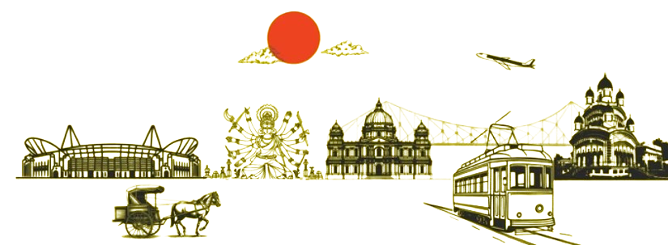

<div align="center">




<a href="https://prajak-dev.vercel.app/"></a>
<a href="mailto:prajaksen.s@gmail.com"></a>
<a href="https://twitter.com/92prajak"></a>
<a href="https://medium.com/@prajaksen1947"></a>

</div>

<br/>

```text
┌─[ prajak@kolkata ]──────────────────────────────────────────── [ whoami ] ─┐
│                                                                            │
│   now        → 3D foundation models, and where they quietly hallucinate    │
│   exploring  → world models, JEPA-style prediction, VLA policies           │
│   side quest → ARC-AGI, neuro-symbolic RL                                  │
│   belief     → pre-register it. report it honestly. ship it.               │
│                                                                            │
│   x ──▶ LN ──▶ Attn(Q,K,V) ──⊕──▶ LN ──▶ FFN ──⊕──▶ x'       loss ↓ ok    │
│   └───────────────────────────┘      └──────────┘                          │
└────────────────────────────────────────────────────────────────────────────┘
```

#### `> ls ~/things-i-made`

```text
  drwxr-xr-x  geometry/   3D models that invent surfaces they never saw
  drwxr-xr-x  worlds/     small environments with learned dynamics
  drwxr-xr-x  embodied/   robots, language, a simulated wet lab
  drwxr-xr-x  symbolic/   geometry as a bridge between tasks
```

- [**DTU-3D-reconstruction**](https://github.com/prajak002/DTU-3D-reconstruction) · `geometry/` do 3D models invent geometry they never saw?
- [**Heteroworld**](https://github.com/prajak002/Heteroworld) · [**densewalk**](https://github.com/prajak002/densewalk) · `worlds/` small worlds, learned dynamics
- [**PragyaVLA**](https://github.com/prajak002/PragyaVLA) · [**AutoBio**](https://github.com/prajak002/AutoBio-Virtual-Biology-Lab-Prototype) · `embodied/` robots, language, a simulated wet lab
- [**symbolic-geometry-transfer**](https://github.com/prajak002/symbolic-geometry-transfer) · `symbolic/` invariant geometry bridges for neuro-symbolic RL

#### `> cat /proc/toolchain`


#### `> tail -n 2 ~/writing.log`

<!-- BLOG-POST-LIST:START -->
- [Unveiling the Power of Multithreading: Revolutionizing Scalability in Single-Client Server Design](https://blogoverflow.hashnode.dev/unveiling-the-power-of-multi-threading-revolutionizing-scalability-in-single-client-server-design)
- [Zero-copy IO for Streaming Sockets in C: Efficient Data Transfer with Pre-allocated Buffers](https://blogoverflow.hashnode.dev/zero-copy-io-for-streaming-sockets-in-c-efficient-data-transfer-with-pre-allocated-buffers)
<!-- BLOG-POST-LIST:END -->

<br/>

<div align="center">



<br/>
<sub><code>কলকাতা · open to collaborations · no rush, just curiosity · _</code></sub>

</div>
